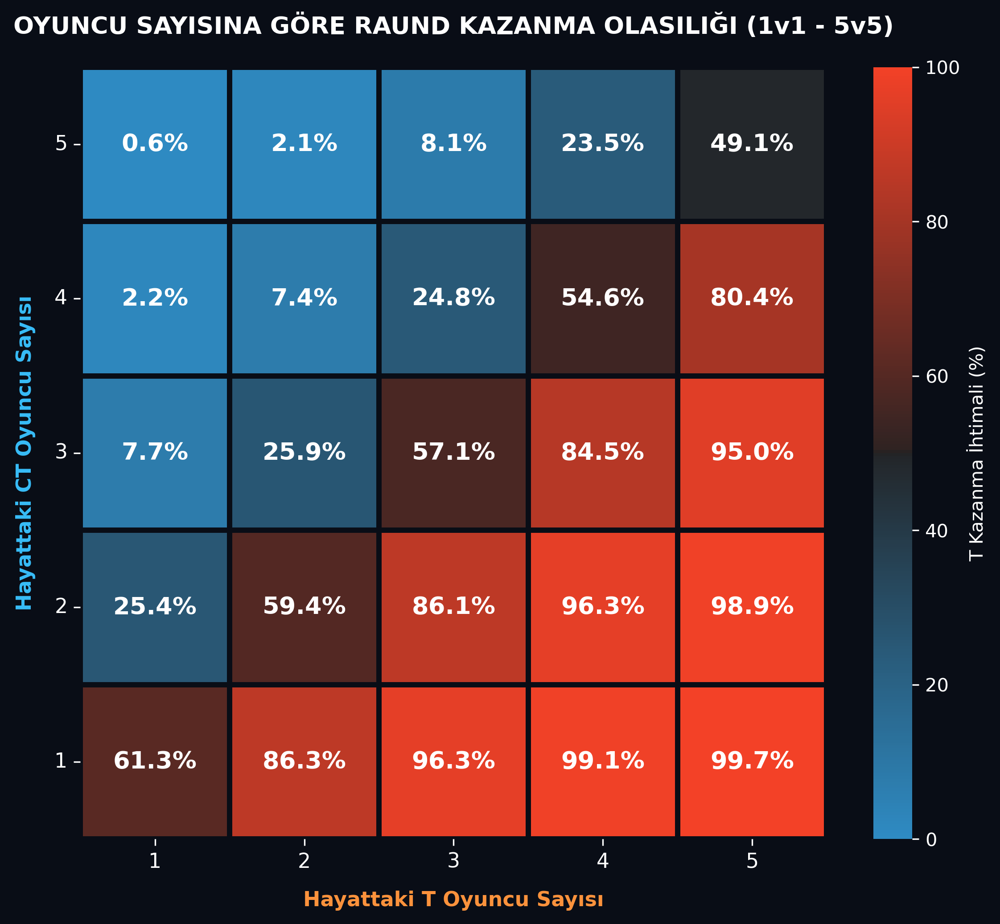
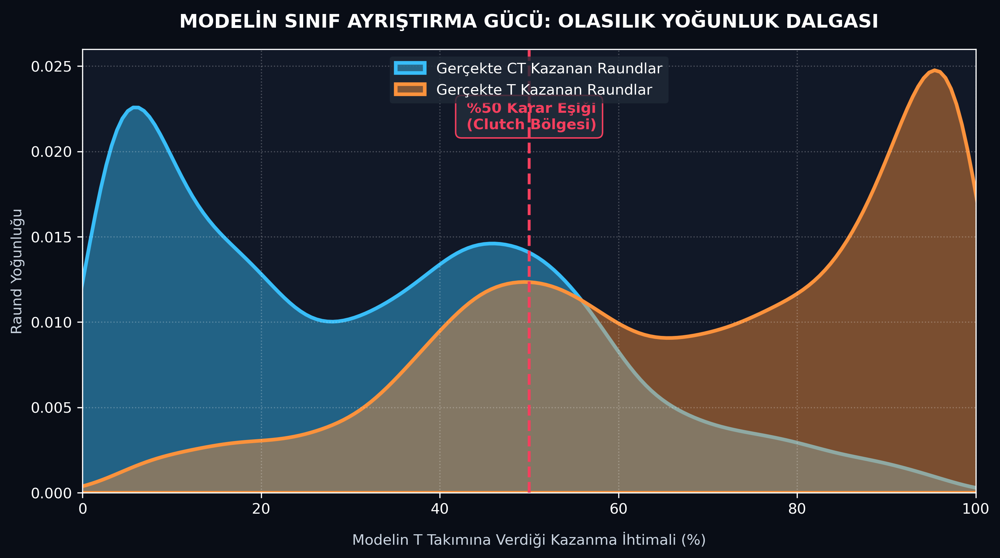
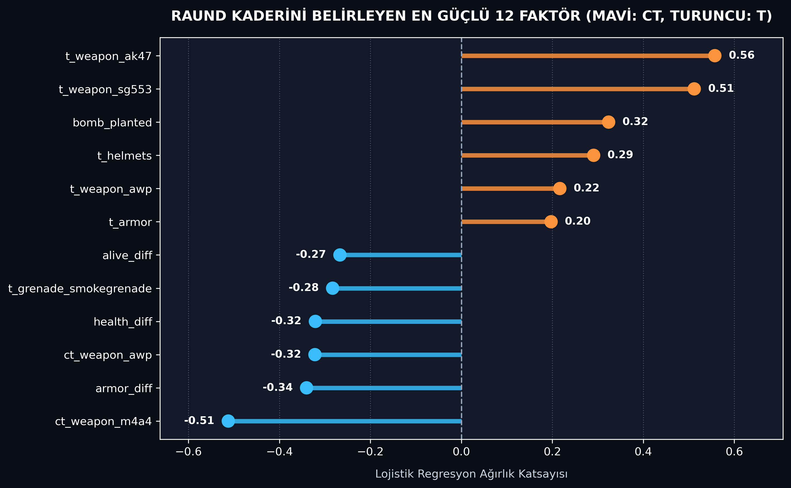

# 🎯 Counter-Strike: Real-Time Round Winner & Win Probability Analysis

Bu proje, profesyonel Counter-Strike maçlarındaki anlık oyun içi verileri (ekonomi, hayattaki oyuncu sayısı, can/zırh durumu, silah envanteri ve bomba durumu) kullanarak raundu hangi takımın kazanacağını tahmin eden ve **canlı yayınlardaki anlık kazanma olasılığı (Win Probability %)** simülasyonunu gerçekleştiren bir Makine Öğrenmesi çalışmasıdır.

---

## 📊 Veri Seti ve Kapsam
* **Veri Boyutu:** 122.410 raund içi anlık görüntü (snapshot) ve 97 ham özellik (feature).
* **Hedef Değişken:** `round_winner` (`0`: Counter-Terrorist [CT], `1`: Terrorist [T]).
* **İncelenen Faktörler:** Takım ekonomileri, ekipman/silah dağılımları (AK-47, M4A4, AWP, SG553 vb.), kalan süre, bomba durumu (`bomb_planted`) ve harita bilgileri.

---

## 🛠️ Metodoloji ve Uygulanan Adımlar

1. **Veri Ön İşleme (Preprocessing & Encoding):**
   * Mantıksal (`boolean`) değişkenlerin sayısal formata çevrilmesi.
   * Harita (`map`) değişkenleri için *One-Hot Encoding* (`drop_first=True`) uygulanması.
2. **Özellik Mühendisliği (Feature Engineering):**
   * Oyun içi alan bilgisi (domain knowledge) kullanılarak iki takım arasındaki anlık üstünlüğü temsil eden 4 yeni fark değişkeni türetildi ve toplam özellik sayısı **106**'ya çıkarıldı:
     * `health_diff` (Toplam Can Farkı)
     * `armor_diff` (Toplam Zırh Farkı)
     * `money_diff` (Ekonomi / Bütçe Farkı)
     * `alive_diff` (Hayattaki Oyuncu Sayısı Farkı)
3. **Veri Sızıntısını Önleme (Data Leakage Prevention) & Ölçeklendirme:**
   * Veri `%80 Eğitim (97.928 raund)` ve `%20 Test (24.482 raund)` olarak ayrıldıktan sonra `StandardScaler` yalnızca eğitim setine `fit` edilerek ölçeklendirildi.
4. **Modelleme ve Olasılık Çıkarımı:**
   * **Logistic Regression** modeli eğitilerek hem sınıf tahminleri (`predict`) hem de canlı yayın tarzı yüzdelik kazanma ihtimalleri (`predict_proba`) elde edildi.

---

## 📈 Model Performansı ve Görsel Analizler

Model, test setindeki **24.482 raund** üzerinde **%75 Doğruluk (Accuracy)** ve **~0.85 ROC-AUC** skoru elde etmiştir.

### 1. Taktiksel Sayı Üstünlüğü Matrisi (1v1 - 5v5)
Hayattaki CT ve T oyuncu sayılarına göre modelin T takımına verdiği ortalama kazanma olasılıkları:

### 2. Modelin Sınıf Ayrıştırma Gücü (Probability Density Wave)
Modelin ürettiği olasılıkların gerçek maç sonuçlarına göre yoğunluk dağılımı ve `%50 Clutch / Belirsizlik Eşiği`:

### 3. Raund Kaderini Belirleyen En Güçlü 12 Faktör
Lojistik Regresyon modelinin karar verirken en yüksek ağırlık (katsayı) atadığı oyun içi değişkenler:

---

## 💡 Temel Çıkarımlar (Key Insights)
* **Sayı ve Can Üstünlüğü:** Türetilen fark değişkenleri (`health_diff`, `armor_diff`, `alive_diff`) ve hayattaki oyuncu sayıları modelin karar mekanizmasındaki en baskın faktörler olmuştur.
* **Silah Metası Matematiği:** Katsayı analizinde CT tarafında `M4A4` ve `AWP`, T tarafında ise `AK-47` ve `SG553` sahip olunması raund kazanma olasılığını doğrudan yukarı taşıyan en kritik envanter kalemleri olarak öne çıkmıştır.
* **Clutch Dinamiği:** 5v5 dengesinde `%48-%52` bandında seyreden olasılıklar, tek bir açılış skoru (entry frag) ile 5v4 veya 4v5 durumuna geçildiğinde dramatik şekilde kırılmaktadır.

---

## 🚀 Kullanılan Teknolojiler
* **Dil:** Python
* **Kütüphaneler:** Pandas, NumPy, Scikit-Learn, Matplotlib, Seaborn
* **Geliştirme Ortamı:** Spyder IDE
